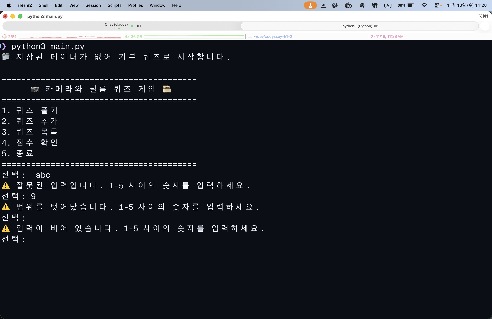
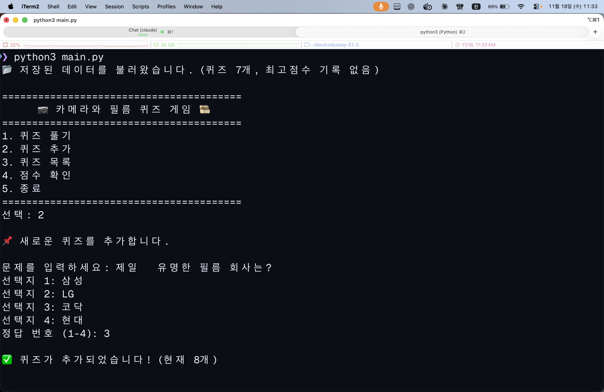
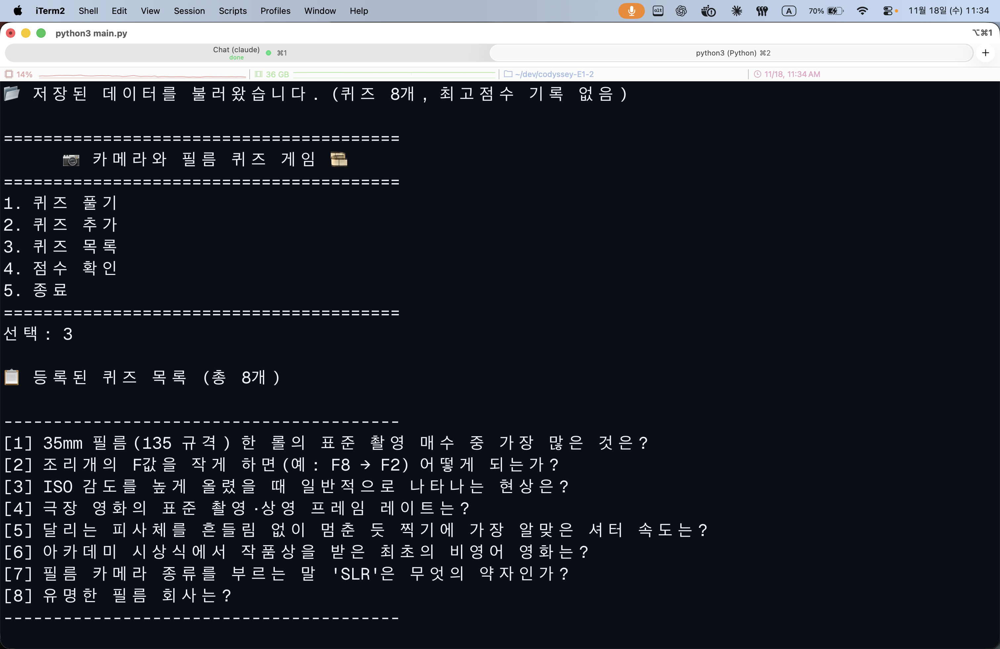
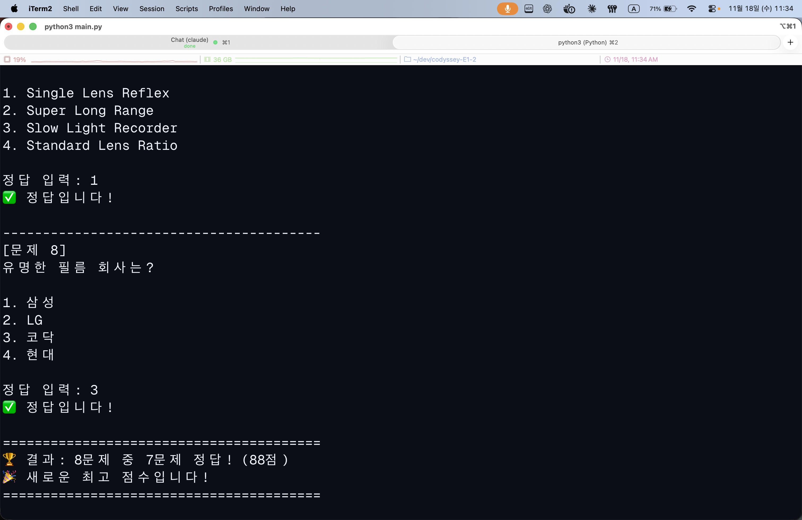
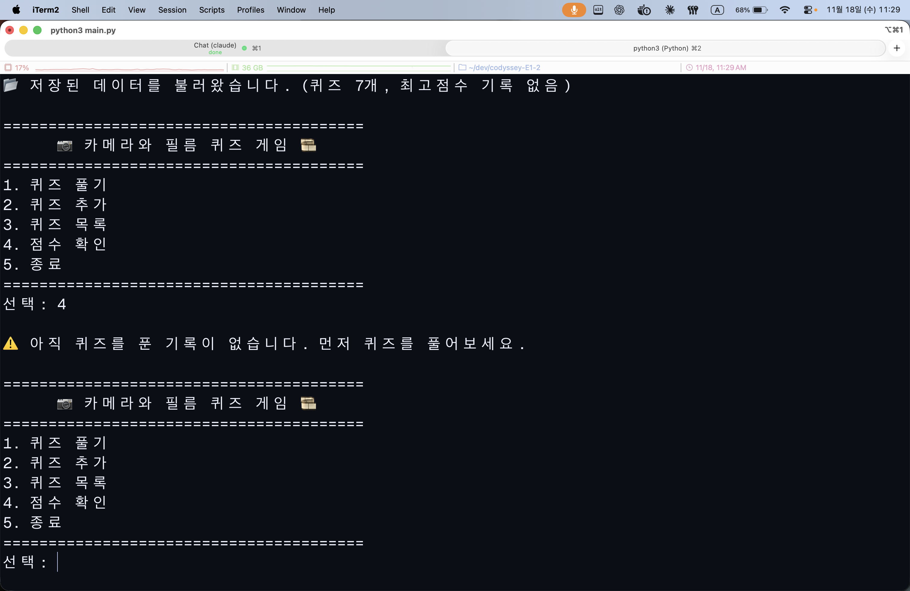
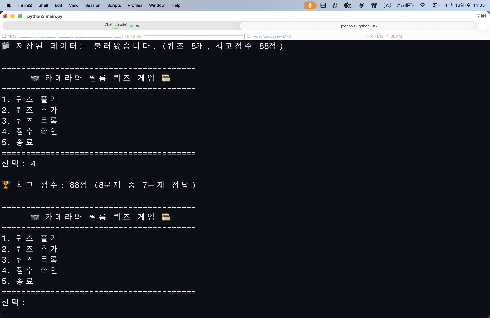
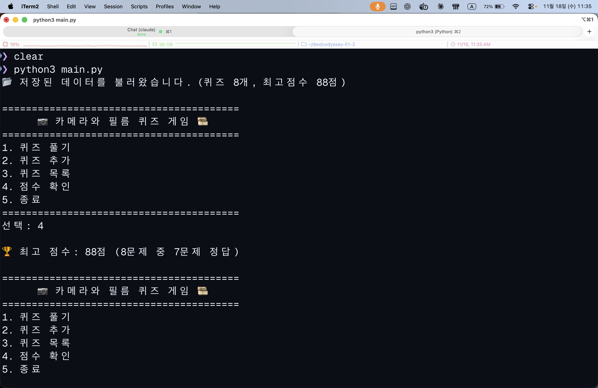
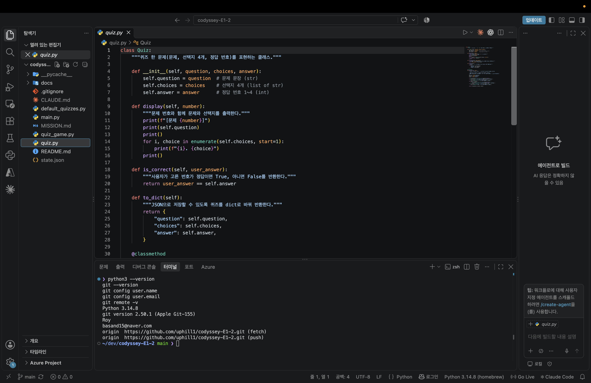
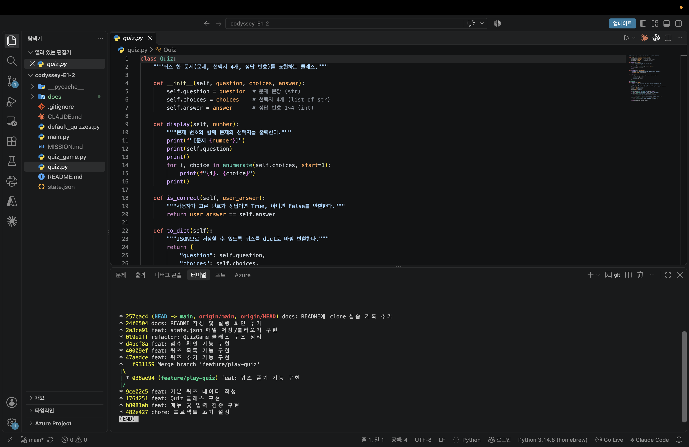

# 카메라와 필름 퀴즈 게임

## 프로젝트 개요

터미널에서 동작하는 4지선다 퀴즈 게임입니다. 메뉴에서 번호를 골라 퀴즈를 풀고, 새 퀴즈를 추가하고, 목록과 최고 점수를 확인할 수 있습니다.

- Python 표준 라이브러리만 사용합니다. (외부 패키지 없음)
- `Quiz`(퀴즈 한 문제)와 `QuizGame`(게임 전체 관리) 두 클래스로 역할을 나눴습니다.
- 퀴즈와 최고 점수는 `state.json`에 저장되어, 프로그램을 종료했다가 다시 실행해도 유지됩니다.
- 잘못된 입력, Ctrl+C, 입력 종료(EOF), 저장 파일 손상 같은 상황에서도 프로그램이 비정상 종료되지 않습니다.

## 퀴즈 주제와 선정 이유

**주제: 카메라 · 필름 · 영화**

사진동아리 회장으로 활동하고 있어서, 가장 가깝고 자신 있는 분야인 사진과 필름을 주제로 정했습니다. 조리개, 셔터 속도, ISO처럼 사진을 찍을 때 꼭 알아야 하는 개념과 필름 규격, 영화 프레임 레이트 같은 내용은 정답이 분명해서 4지선다 퀴즈로 만들기에 잘 맞습니다. 기본 퀴즈 7개를 직접 작성했습니다.

## 실행 방법

**요구 환경:** Python 3.10 이상

```bash
git clone https://github.com/uphill1/codyssey-E1-2.git
cd codyssey-E1-2
python3 main.py
```

- 첫 실행 시 `state.json`이 없으면 기본 퀴즈로 시작하고, 저장할 때 파일이 자동으로 만들어집니다.
- 처음 상태로 되돌리려면 `state.json`을 삭제하고 다시 실행하면 됩니다.

## 기능 목록

| 메뉴 | 기능 | 설명 |
|---|---|---|
| 1 | 퀴즈 풀기 | 판마다 등록된 퀴즈의 순서를 무작위로 섞어 출제하고, 문제마다 정답/오답을 알려줍니다. 다 풀면 맞힌 개수와 점수(100점 만점)를 보여주고, 최고 점수를 넘으면 갱신합니다. |
| 2 | 퀴즈 추가 | 문제, 선택지 4개, 정답 번호(1~4)를 입력받아 새 퀴즈를 등록하고 파일에 저장합니다. |
| 3 | 퀴즈 목록 | 등록된 퀴즈의 문제를 번호와 함께 보여줍니다. (정답은 표시하지 않음) |
| 4 | 점수 확인 | 최고 점수와 그때의 정답 수를 보여줍니다. |
| 5 | 종료 | 현재 상태를 저장하고 프로그램을 종료합니다. |

**입력 및 예외 처리**

- 숫자 입력 (메뉴 1~5, 정답 1~4)
  - 앞뒤 공백을 제거한 뒤 처리합니다. (` 3 ` → `3`)
  - 빈 입력, 숫자가 아닌 입력(`abc`), 범위 밖 숫자(`0`, `9`)는 안내 메시지를 보여주고 다시 입력받습니다.
- 문자 입력 (문제, 선택지): 빈 값이면 다시 입력받습니다.
- 퀴즈가 없거나 아직 푼 기록이 없으면 안내 메시지를 보여줍니다.
- Ctrl+C(`KeyboardInterrupt`)나 입력 종료(`EOFError`)가 발생하면 안내 후 저장하고 안전하게 종료합니다.

## 실행 화면

| 메뉴 · 잘못된 입력 처리 | 퀴즈 추가 |
|---|---|
|  |  |

| 퀴즈 목록 | 퀴즈 풀기 |
|---|---|
|  |  |

| 점수 확인 (기록 없음) | 점수 확인 |
|---|---|
|  |  |

**재시작 후 데이터 유지**



## 파일 구조

```
codyssey-E1-2/
├── main.py              # 프로그램 시작점: QuizGame을 만들고 run() 호출
├── quiz_game.py         # QuizGame 클래스: 메뉴, 입력 처리, 게임 진행, 점수, 파일 저장/불러오기
├── quiz.py              # Quiz 클래스: 퀴즈 한 문제(문제/선택지/정답), 출력, 정답 확인, dict 변환
├── default_quizzes.py   # 기본 퀴즈 7개를 Quiz 객체 목록으로 반환
├── docs/
│   └── screenshots/     # README용 실행 화면 캡처
├── state.json           # 실행 중 생성되는 데이터 파일 (Git에 올리지 않음)
├── .gitignore
└── README.md
```

**클래스 구성**

| 클래스 | 역할 | 주요 메서드 |
|---|---|---|
| `Quiz` | 퀴즈 한 문제 | `display()`, `is_correct()`, `to_dict()`, `from_dict()` |
| `QuizGame` | 게임 전체 관리 | `run()`, `show_menu()`, `play_quiz()`, `add_quiz()`, `list_quizzes()`, `show_score()`, `ask_int()`, `ask_text()`, `update_best_score()`, `save_state()`, `load_state()` |

## 데이터 파일 설명 (state.json)

**경로:** 프로젝트 루트의 `state.json`

- `quiz_game.py`가 있는 폴더를 기준으로 경로를 정하므로, 어느 위치에서 실행해도 같은 파일을 사용합니다.
- 실행할 때마다 내용이 바뀌는 데이터라 `.gitignore`로 저장소에서 제외했습니다.

**역할:** 추가한 퀴즈와 최고 점수를 저장해서, 프로그램을 다시 실행해도 데이터가 유지되게 합니다.

**인코딩:** UTF-8 (한글을 그대로 저장)

**저장 시점**

- 퀴즈를 추가했을 때
- 최고 점수가 갱신됐을 때
- 메뉴 5번으로 종료할 때
- Ctrl+C 또는 입력 종료(EOF)로 끝날 때

**필드 구조**

| 키 | 타입 | 설명 |
|---|---|---|
| `quizzes` | list | 퀴즈 목록. 각 항목은 아래 세 키를 가진 객체 |
| `quizzes[].question` | str | 문제 |
| `quizzes[].choices` | list[str] | 선택지 4개 |
| `quizzes[].answer` | int | 정답 번호 (1~4) |
| `best_score` | int 또는 null | 최고 점수 (0~100점). 아직 푼 기록이 없으면 `null` |
| `best_correct` | int | 최고 점수를 냈을 때 맞힌 문제 수 |
| `best_total` | int | 최고 점수를 냈을 때 전체 문제 수 |

**예시**

```json
{
  "quizzes": [
    {
      "question": "35mm 필름(135 규격) 한 롤의 표준 촬영 매수 중 가장 많은 것은?",
      "choices": ["12장", "24장", "36장", "48장"],
      "answer": 3
    }
  ],
  "best_score": 88,
  "best_correct": 7,
  "best_total": 8
}
```

**파일이 없거나 손상된 경우**

| 상황 | 동작 |
|---|---|
| 파일 없음 (첫 실행) | 기본 퀴즈로 시작합니다. |
| JSON 문법 오류, 키 누락, 잘못된 값 (예: 선택지가 4개가 아님, 정답이 1~4 범위 밖, 점수가 0~100 범위 밖) | 안내 메시지를 보여주고 기본 퀴즈 데이터로 복구(초기화)합니다. |
| 읽기/쓰기 권한 오류 | 안내 메시지를 보여주고 게임은 계속 진행합니다. |

## 개발 환경

- macOS, VSCode
- Python 3.14.8 (3.10 이상 필요)
- Git 2.50.1



## Git 실습 기록

- 기능 단위로 커밋했습니다. (메뉴 → Quiz 클래스 → 기본 데이터 → 퀴즈 풀기 → 추가 → 목록 → 점수 → 구조 정리 → 파일 저장 → README)
- 퀴즈 풀기 기능은 `feature/play-quiz` 브랜치에서 작업한 뒤, 병합 기록이 남도록 `git merge --no-ff`로 main에 병합했습니다.
- clone한 저장소(`codyssey-E1-2-clone`)에서 이 섹션을 추가해 commit → push 하고, 원래 작업 폴더에서 `git pull`로 변경사항을 가져와 반영을 확인했습니다.

**`git log --oneline --graph`**


